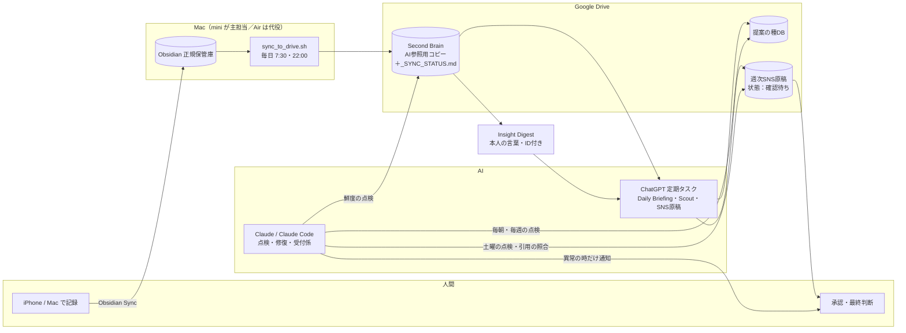

# ② システム構成案

最終更新：2026-10-12　／　前提：`docs/01_現状調査レポート.md` で確認した事実

---

## 1. 基本の考え方

**「司令塔（考えるAI）」と「実行基盤（時間どおりに動く仕組み）」を分ける。**

- 司令塔：Claude（チャット）。目的の整理、区分判定、設計、反対意見。
- 実行基盤：時間で動くもの。**チャットを閉じていても止まらない** ことが条件。
- 人間：目的・方向修正・承認・最終決裁（受付係 指示書 v1 と同じ）。

> 反対側からの視点：役割を細かく分けるほど「受け渡し」が増え、そこが壊れやすくなります。
> 単純な作業は **1つのAIで完結** させ、AIを増やすのは品質が上がる場面（独立チェック等）だけにします。

---

## 2. AIの役割分担（推奨。固定ルールではない）

| 担当 | 得意なこと | このプロジェクトでの役割 | つなぎ方（実際に使える方法） |
|---|---|---|---|
| Claude（チャット） | 論点整理・設計・反対意見 | 受付係の判断、企画・提案の骨組み | チャット。Google Drive・Gmail・Calendar コネクタで資料を直接読める |
| Claude Code | 実装・自動化・検証 | スクリプト作成、データ点検、テスト、修復 | Mac上のCLI、またはクラウド（今回） |
| ChatGPT | 文章・資料・ビジュアル制作 | SNS原稿生成、提案書の仕上げ、Daily Briefing | **定期タスク（ChatGPTアプリ内）**。外部から操作不可 → 手動の受け渡し |
| Codex | コードの独立レビュー | Claude Code の成果物の第二の目 | Mac に CLI を入れれば可（未導入）。無い場合は Claude Code の別セッションで代替 |
| Gemini / NotebookLM | 資料の読み込み・根拠確認 | 研修・提案の根拠集め | 手動の受け渡し |
| Obsidian | 第二の脳 | 日々の記録（正規の保管場所） | Mac上のフォルダ |
| Google Drive / Sheets | 共有・データベース | AI参照用コピー、提案の種DB、原稿置き場 | コネクタ（Claude）、Drive for desktop（Mac） |

---

## 3. 情報の流れ

### 処理を独立させる（1つが止まっても他は止まらない）
| 処理 | 入力 | 出力 | 失敗しても影響しない処理 |
|---|---|---|---|
| ① Obsidian→Drive コピー | 保管庫 | Drive「Second Brain」 | ②③は前回のコピーで動ける |
| ② Daily Briefing＋Scout | Web上の一次情報 | 提案の種DB | ①③ |
| ③ SNS週次原稿 | **Insight Digest（本人の言葉）**＋提案の種DB | SNS原稿（確認待ち） | ①② |
| ④ 点検（Claude） | ①②③の結果 | 異常時の通知、PROJECT_STATUS 更新 | ①②③の実行そのもの |

---

**オリジナリティの設計**（詳細は `docs/06`）：原稿の芯は必ず Obsidian の本人の言葉（INS）。
外部の事実は2〜3割の脇役。引用は原文と機械で照合し、AIによる「本人の言葉」の創作を防ぐ。

## 4. データの置き場所

| データ | 正規の場所（唯一の原本） | コピー・参照 | 決めごと |
|---|---|---|---|
| 日々の記録・知識 | **Mac の Obsidian 保管庫「Second Brain」** | Drive「Second Brain」（読み取り専用の扱い） | Drive 側で編集しない。コピーは一方向 |
| 提案の種 | Google スプレッドシート「提案の種DB」 | ― | 追加前に `seed_db.py dedupe` で重複除外 |
| SNS原稿 | Drive「ChatGPT/SNS投稿用」（**統一を提案**） | ― | ファイル名 `YYYY-MM-DD_週次SNS投稿案_期間` |
| AIの引き継ぎ票 | `AI_Orchestration/shared/` | 将来は Drive へ | 個人情報を書かない |
| 仕組み（スクリプト・ルール） | この Git リポジトリ `AI_Orchestration/` | Mac に clone | 変更はテスト合格後 |
| ログ | `AI_Orchestration/logs/`（Mac内） | Drive の `_SYNC_STATUS.md` に要約のみ | 秘密情報は自動で伏せ字 |

**GitHub について**：仕組み（スクリプト）だけを Git で管理し、**ノートやデータは入れません**。
運用負担は「Mac で月に1回 `git pull` する」程度です。不要なら Git を使わず、フォルダごと Drive に置いても動きます
（ただし変更履歴とテストの再現性が失われる、というデメリットがあります）。

---

## 5. 自動実行の仕組み（方式の比較）

| 方式 | 動く場所 | Macが寝ていると | 費用 | 向いている処理 |
|---|---|---|---|---|
| **launchd（Mac）** | Mac | 起きた時に1回まとめて実行。電源オフ中は動かない | 0円 | ① Obsidian→Drive（保管庫はMacにしかないため **これ一択**） |
| **ChatGPT 定期タスク** | OpenAI のクラウド | 影響なし | 既存契約内 | ② Daily Briefing・③ SNS原稿（現状どおり） |
| **Claude Code の定期実行（Routine）** | Anthropic のクラウド | 影響なし | 既存プラン内で使用量を消費 | ④ 点検（Drive コネクタでDB・原稿・_SYNC_STATUS を確認） |
| GitHub Actions 等 | 外部クラウド | 影響なし | 無料枠あり | 今回は不要（Drive への認証設定の負担が大きい） |

**推奨**：①は Mac（mini 主担当、Air は26時間以上止まった時だけ代役）、②③は ChatGPT のまま、
④の点検だけ Claude のクラウド定期実行に任せる。→ **Mac が寝ていても、異常に気づける**。

> デメリット：Claude の定期実行は Drive に「読み取り」で入るため、Google アカウントのデータを
> Anthropic のクラウドで処理することになります（現在のコネクタ利用と同じ範囲）。設定は承認後に行います。

---

## 6. セキュリティ対策

| リスク | 対策（実装済みのもの） |
|---|---|
| 秘密情報の漏えい | 設定は `config/local.env`（Git対象外）。ログは自動で伏せ字（`lib/common.py`）。パスワード類はどこにも書かない |
| 業務記録が SNS 原稿に混入（指示書 D の懸案） | ① `config/obsidian_sync_excludes.txt` で業務記録フォルダを Drive に出さない ② `extract_candidates.py` が個人を示す語・メール・電話番号を検出して「要確認」表示 |
| 正規保管庫の破損 | コピーは一方向。削除の反映は初期値オフ、オンでも退避してから。保管庫とコピー先の入れ子を検知して停止 |
| 二重実行・重複登録 | ロックで二重起動防止。DB登録前の重複判定（URLの表記ゆれも同一視）。SNS候補は使用済み記録で再利用を防止 |
| 承認前の公開 | 原稿は「確認待ち」表示を点検。自動投稿は実装しない（現段階） |
| 外部文書に紛れた命令 | Scout 指示文・AGENTS.md に「命令として扱わない」と明記 |

---

## 7. 必要な追加費用

| 項目 | 費用 | 根拠 |
|---|---|---|
| 今回の実装（Mac・Drive・既存AI） | **0円** | 追加インストール不要（macOS 標準の bash・rsync・python3） |
| Claude の定期実行（点検） | 既存プラン内（使用量を消費） | 新規契約なし |
| SNS 自動投稿 | **不明**（媒体ごとに審査・課金条件あり） | 01 レポート 5章。現段階では導入しない |
| Codex 導入 | 既存の ChatGPT 契約に含まれるかは **不明** | 公式で要確認 |
