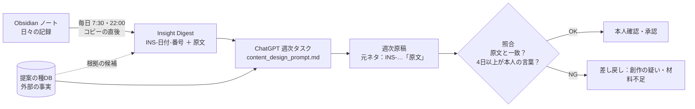

# ⑥ Obsidian の言葉を、コンテンツ設計の「芯」にする

最終更新：2026-10-12

## ポイント（3行）
- **今の仕組みの弱点**：材料選びが `#発信候補` タグ頼みで、9/24 以降はタグ付きノートが0件。一方、日々のノートには健康経営などについての本人の考察が書かれている（10/7・10/10・10/12）。**良い材料が眠ったまま**になっている。
- **新しい仕組み**：ノートを「1つの考え＝1ブロック」に分け、本人の言葉を **原文のまま・ID付き** で渡す（Insight Digest）。原稿は必ずその1つを芯にし、引用を添える。
- **確かめ方**：原稿の引用が本人の原文と **一字一句一致するか** を機械で照合する。AIが「本人の言葉らしいもの」を作ってしまう事故を防ぐ。

---

## 1. なぜ「原文のまま」にこだわるのか

AIに「Obsidian を参考に書いて」と頼むと、次のことが起きやすくなります（**推測**：一般的な生成AIの性質から）。

| 起きること | 結果 |
|---|---|
| 本人の考えが要約され、一般論に近づく | 誰が書いても同じ文章になる |
| 足りない部分を、もっともらしい体験で補う | **本人が経験していない話** が本人名義で出る |
| 外部の事実が主役になる | 「調べればわかること」の投稿になる |

そこで役割を固定します。

- **主役**：Obsidian の本人の言葉（問い・気づき・体験）… AI には作れない部分
- **脇役**：提案の種DB の外部の事実 … 本人の考えを支える根拠（全体の2〜3割）
- **AIの仕事**：選ぶ・並べる・媒体に合わせて整える。**中身を足さない**

---

## 2. 流れ



| 段階 | 置き場所 | 担当 |
|---|---|---|
| Insight Digest 作成 | Drive「Second Brain/_AI_digest/insight_digest_latest.md」（と .json） | Mac（コピーの直後に自動） |
| 原稿づくり | Drive「SNS投稿用」 | ChatGPT 週次タスク（指示文を差し替え） |
| 照合 | ― | Claude の点検（クラウド）または Mac の `validate_weekly_draft.py --digest` |
| 承認・自分の言葉に戻す | ― | ゆうだいさん |

---

## 3. Insight Digest の中身（例：テスト用の架空ノートから作成）

```
## INS-20261012-1｜問い（健康経営・組織・人材）
- 出典ノート：Daily/2026-10-12.md（2026-10-12）／見出し：健康経営の役割
> 働く人に健康行動を求めることから、健康で働きやすい環境を組織がつくることへ、
> どこまで役割を広げるべきなのか？ …
- 根拠の候補（機械的な一致・近さ0.31）：20260926-01 職場環境 × 五感 × 回復｜…
```

**取り出すもの・取り出さないもの**

| 取り出す | 取り出さない |
|---|---|
| 問い（〜だろうか、〜べきなのか？） | ニュースや資料の書き写し（URL・「〜によると」中心） |
| 気づき・主張（〜と思う、〜ではないか、大切なのは） | 短いメモ（40字未満） |
| 体験（研修で・現場で・今日〜した） | 業務記録フォルダ（設定で除外） |
| `#発信候補` を付けたもの（最優先） | 個人が特定されうる記述（**本文は渡さず、場所だけ「要確認」に表示**） |
| 「問い：」「気づき：」「体験：」で始まるもの（確実に拾う） | 一度使った気づき（記録した場合） |

---

## 4. ゆうだいさんの書き方（変えなくてよい／少し変えると効く）

- **今まで通りでよい**：区切り線 `--` や見出しで話題を分けている書き方は、そのまま1ブロックとして拾えます。
- **少し効く工夫（任意）**：発信に使ってほしい一文の頭に `問い：` `気づき：` `体験：` と付ける。
  iPhone から1行で書けます。例：`問い：健康診断の結果を、本人が自分の言葉で語れる場はあるだろうか`
- `#発信候補` は「特に使ってほしい」印として最優先されます（無くても拾います）。

---

## 5. 確認したこと（事実）と、まだ確認していないこと

| 項目 | 状態 |
|---|---|
| 架空ノートでの取り出し・除外・ID・個人情報の非表示 | テスト合格 |
| 引用の照合（原文一致は合格、書き換え・創作・存在しないIDはエラー、改行をまたぐ引用も一致） | テスト合格 |
| 材料不足の週に「不足：n本」と宣言すれば、本数が少なくても合格扱い | テスト合格 |
| 実物の提案の種DB（21件）との根拠の突き合わせ | 実行済み。**近い Seed が見つかったのは一部だけ**（下記の限界） |
| **実物の Obsidian ノートでの取り出し品質** | **未確認**（Mac で実行が必要。クラウドからは本文を処理していません） |
| ChatGPT 週次タスクへの指示文の適用 | 未実施（ChatGPT 側は本人のみ操作可） |

### 限界（あえて書きます）
- **根拠の機械的な突き合わせは弱い**：文字の重なりで比べるため、言い換え（例「自走」と「行動変容」）は拾えません。
  実物のDBで試したところ、はっきり近いと言えたのは一部だけでした。そのため **基準未満なら何も添えず**、根拠選びは
  原稿を書くAIが意味で行う設計にしました。
- **「本人の声らしさ」の判定は言い回し頼み**：「〜と思う」が無い鋭い一文を見落とすことがあります。
  `問い：` などの印が確実です。逆に、気持ちが書かれた私的な日記を拾うこともあるため、**承認時の目視は省けません**。
- **個人情報の検出は安全網であって完全ではない**：「さん」付けでない名前などは検出できません。
  受付係 指示書の **D-2（業務記録と発信ノートの分離）を先に行うことを強く推奨** します。
  なお、ChatGPT はすでに Drive の保管庫コピー全体を読める状態なので、Digest によって AI に渡る範囲が **増えるわけではありません**
  （むしろ「使ってよい部分」を絞って渡す形になります）。

---

## 6. 反対側からの視点

- **「全部のノートを材料にする」ことへの抵抗感は自然**です。日記は発信のために書いているわけではありません。
  もし違和感があれば、`#発信候補` と `問い：` などの印が付いたものだけを使う運用に切り替えられます（`config/local.env` の `INSIGHT_SCOPE=marked` の1行で変更）。
- **毎週7本は多いかもしれません**。本人の言葉が4本分しか無い週に7本出すと、残り3本は一般論になります。
  「質を保つために本数を減らす」週があってよい、というのがこの設計の立場です。

---

## 7. ゆうだいさんにお願いしたいこと
1. Mac で試しに実行し、**出てきた気づきが「確かに自分の言葉だ」と思えるか** を見る
   → 手順：`docs/07_Macで試す手順_初心者向け.md`（ドラッグ＆ドロップだけで動きます）
2. 問題なければ、ChatGPT の週次SNSタスクの指示文を `content_design_prompt.md` に差し替える。
3. 業務記録フォルダを分けたら、`config/obsidian_sync_excludes.txt` に追加する（D-2）。
